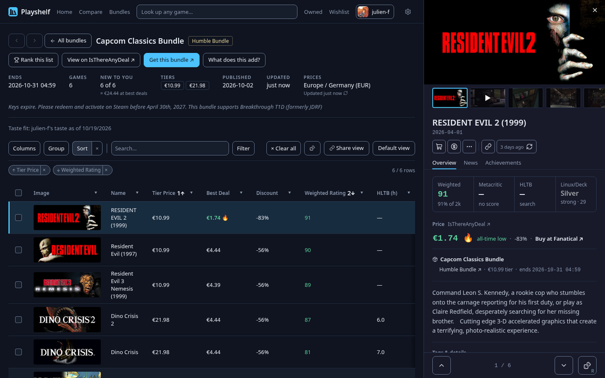
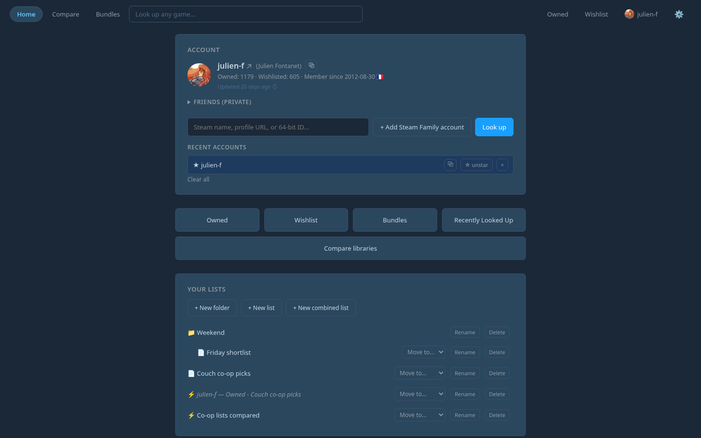
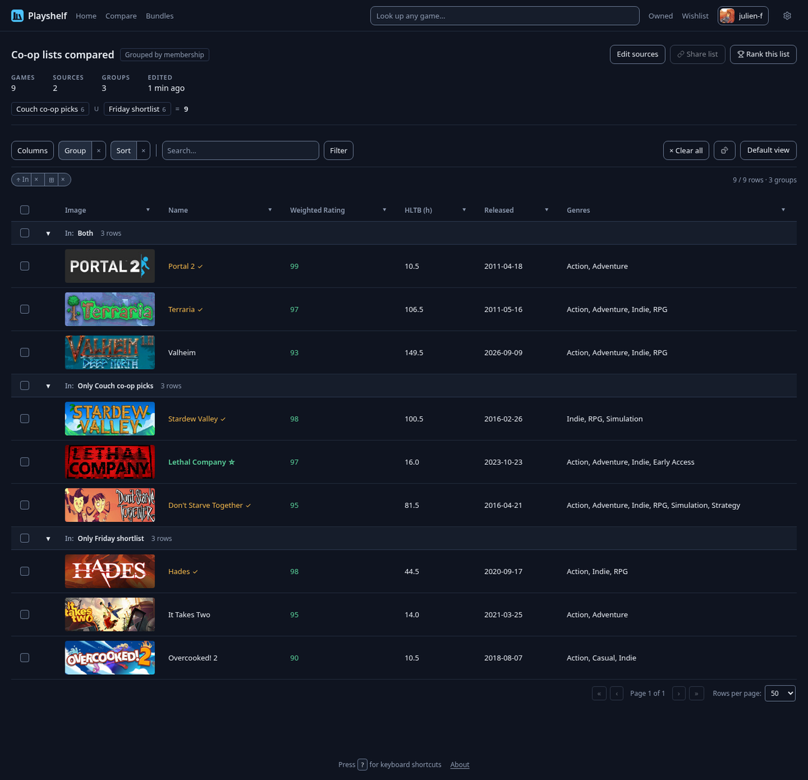
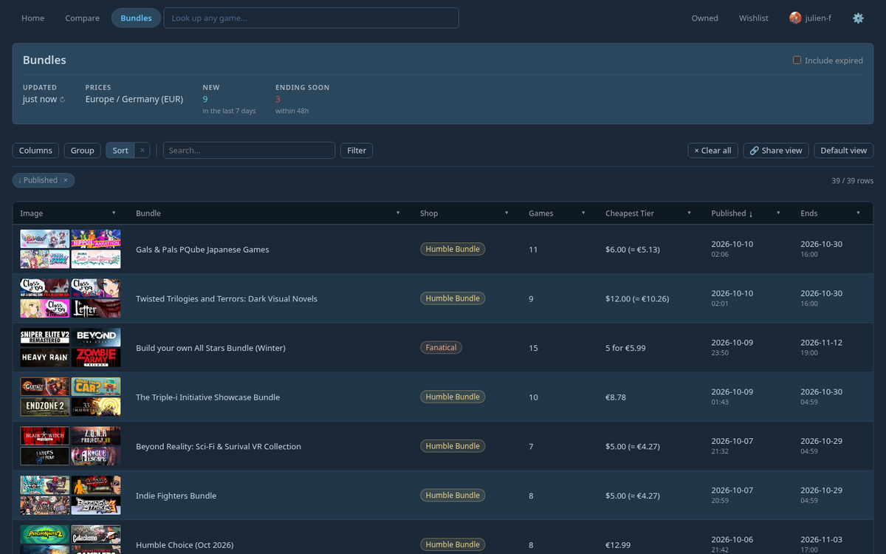
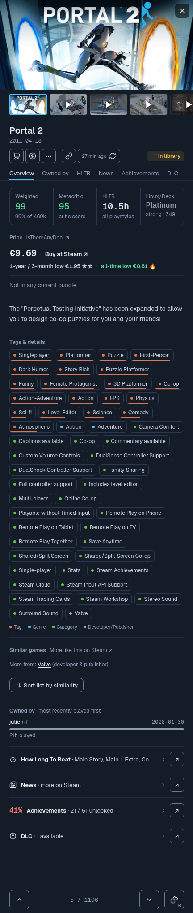

# What the app does

Everything the app shows is a **list of games** — an account's owned games, its wishlist, a bundle, games you looked up, or a list you made yourself — and every list opens in the same viewer: a sortable, filterable, groupable table with a detail panel beside it.

There is no account to create. The accounts you look at, the lists you build and your preferences live in your own browser — unless you sign in with Steam to [sync them](#sync) across devices.

- [Accounts](#accounts)
- [Lists](#lists)
  - [Combining lists](#combining-lists)
  - [Ranking a list](#ranking-a-list)
  - [Comparing libraries](#comparing-libraries)
- [Bundles](#bundles)
- [Prices](#prices)
- [The game panel](#the-game-panel)
- [Search by URL](#search-by-url)
- [Sharing](#sharing)
- [Sync](#sync)
- [Keyboard shortcuts](#keyboard-shortcuts)
- [How fresh is this?](#how-fresh-is-this)

## Accounts

Enter a Steam profile URL, vanity name or 64-bit ID on the home page to explore that account. Several identifiers at once resolve into one **Family** — their libraries are merged, so a game anyone in the family owns counts as owned.

- **Current account** — whoever you're exploring right now. The nav bar always says who that is, with one-click links to their **Owned** and **Wishlist** lists.
- **My account** — star an account on Home's account card to pin it as your default.
- **Accounts** you look up are kept, with no limit, as one tile each (avatar and name) on the home page's account card: yours first, then by name, the same order in the nav-bar chip, which switches account without going back home. Hover or focus a tile, or press **Edit**, to remove one; past 8 accounts a filter finds one by name.
- **The copy button copies an account's Steam identifier** — its custom URL name when it has one (`gaben`), its 64-bit ID otherwise — from the home page's account card (one per member for a Family) and from every account in the nav-bar chip. Any remembered account's identifier is one click away, current or not. That's the identifier to hand to someone else, or to paste back into the account field here.

A private profile or wishlist looks identical to an empty one from the outside; the app shows what it can see.

## Lists

- **Owned** and **Wishlist** for the current account, and one list per **bundle** you browse, follow their source — nothing to maintain. Their "Updated" figure says how old they are (see [How fresh is this?](#how-fresh-is-this)).
- **Views** of Owned and Wishlist keep several named layouts of one list (columns, sort, grouping, filters), opened as tabs under its header: **All games**, then each view.
  - **New view** (beside Rank this list) saves the table as it is now, or offers ready-made ones, each showing only the columns that matter to it:
    - **Recently played** (Owned): last played first.
    - **Play next** (Owned): played 2 h or less and not marked Finished or Abandoned (see [Statuses](#statuses)), best Taste fit first.
    - **Short games** (Owned): the same, with a main story of 5 h or less on How Long To Beat, best rated first.
    - **Bargains** (Wishlist): at a 1-year or all-time low, biggest discount first.
  - Changing a view's table doesn't save it: **Save** or **Revert** in the banner above it; leaving the view drops the changes. Its **⋯** renames or deletes it.
  - A view follows the account you're exploring, like Owned and Wishlist themselves; Home's Owned and Wishlist cards link each one.
- **Recently Looked Up** collects the last 500 games you searched for (the search box's dropdown shows the latest 10), latest first (its **Looked up** column), browsable like any other list.
- **PC Game Pass** lists the Steam games currently in PC Game Pass, from the catalog of the region set in Preferences (catalogs differ slightly by country). Game Pass plays them through the Xbox app, not Steam. Its games not on Steam are listed below the table, each linking to its Xbox store page. Combine it with your Wishlist to see what you could play without buying (see [Combining lists](#combining-lists)). Like Bundles, it needs the app's IsThereAnyDeal key.
- **Your own lists** come in three kinds: a **manual** list you add and remove games from, a **dynamic** list defined as a formula over other lists, recomputed every time you open it, and a **ranked** list that orders another list by your preferences (see [Ranking a list](#ranking-a-list)).
- Lists live in a **folder tree** you can rename, nest and organize. Each row shows its kind's icon and what it holds ("List · 12 games", "Ranking · 30 ranked"); its **⋯** menu moves it elsewhere in the tree (**Move to…**), renames or deletes it.
- **Taste fit** (shown on Wishlist and bundles, available on every list): how close each game is to the current account's taste, learned from its Owned list. Open that account's Owned list once on this device first (the line under the list header says so, how old the taste is, or that the account has too few games played; on a link to someone else's list it doesn't ask you to open theirs). It's refreshed on every visit there. This device keeps only the [most recent few accounts' tastes](../dev/lists-and-accounts.md#storage-schema), keeping your ★ and current one's when it saves another, and drops them first when the browser's storage is full: a change to your lists or settings may then clear any of them.
- **Your player profile**, on Owned once every game's details are in, from 5 played games (software such as Wallpaper Engine or RPG Maker counts toward none of it). With no playtime on any game — Steam lets an account keep its playtime private — it says so instead.
  - **An archetype**: Story finisher, Solo explorer, Co-op crew, Competitor or Squad player, from whether the account mostly plays single-player, co-op or PvP games and how many story games it plays through. A Family gets none, its profile mixing its members.
  - **Plays mostly**: the Steam tags the account spends its time on (weighted by playtime, tags most of the library carries counting less), each a bar showing its weight next to the top one, and a button filtering the list by that tag (4 on a phone, 6 otherwise). It says how many played games it's built from.
  - **Story games**: a ring counting the story games played for as long as their main story takes on How Long To Beat; one you marked Finished counts whatever its hours, one marked Abandoned falls short.
  - **Barely played**: how many games were played 2 h or less, with **Play next** opening the **Play next** [view](#lists) — creating it the first time — and a second click going back to All games. Zero hours also covers games played before Steam tracked playtime, or on another account.
  - The play style and story games each need 8 played games (an hour or more). **Why these?** opens the evidence in place: under each tag, the played games counting most toward it with their hours; in the story tile, each story game's hours against its main story (the 5 most played that reached it, then those that fell short); and a folded **How it's counted**. Every game opens its panel.
- **Filtering by Steam tag** (the Tags column, or a tag in a game's panel) ranks the matches by **Tag match**: how strongly players tagged each game with them, from 100% (its top tag) down. With several tags it's their average, or on the filter's **All** mode the weakest one, so a game must carry them all. Filter Tag match (e.g. 50% and up) to keep only the games where the tag really matters. Clearing the tag filter restores the previous sort and drops that Tag match filter. In the game's panel, a gauge under each Steam tag shows that same strength.

### Combining lists

Pick two or more lists and an operation:

- **Union** — everything in any of them.
- **Intersect** — only what they all share.
- **Subtract** — what's in the first but not the others. Pick order sets which source is "first" — the combine form shows your picks as a numbered, reorderable list whenever Subtract is chosen.
- **Group by membership** — one table grouped by combination of sources, so you can see what all three accounts share, what only two do (and who's missing), and so on — with one sort, filter and column setup for all of it. Combining several accounts' Owned lists this way is how you compare libraries.

Naming the combined list is optional: leave the name empty and it's called by what it does — "Alice — Owned ∩ Bob — Owned" — in your list tree and on its own page, updating by itself if you later change its sources or rename an account. Type a name whenever you'd rather have one.

The result is saved as a dynamic list, re-resolved every time you open it. Its page states its formula, names every source, and says what each contributed.

A bundle joins a combine from its own page: **What does this add?** shows that bundle minus your Owned games right away, unsaved and shareable, with the bundle's Tier Price ("Varies" for a pick-and-mix one, whose rate depends on how many you pick) and Best Deal columns and a link back to the bundle. **Save as a list** keeps it, Tier Price included; **Edit sources** then changes it — a Family's Owned, or Group by membership with a friend's. Once IsThereAnyDeal stops listing an ended bundle, a list using it keeps the bundle's last-known games and says so.

### Ranking a list

**Rank this list** (on Owned, Wishlist, a bundle or any of your lists) creates a ranked list and asks you two games at a time: _which do you prefer?_ It starts from what the table shows: games come up in its current order, and if rows are selected — or, with none selected, a filter is on — only those are asked about (the button then reads **Rank N games**); the rest wait for a later Compare. Ranking needs at least 2 of those games.

- **← / →** pick one, **↓** Tie, **S** Skip (asked again later), **X** then **← / →** or "Haven't played" (on your own games; "Not interested" elsewhere) to exclude a game, **Z** Undo. All are buttons too.
- **Details** under a card (or **I** then **← / →**) opens that game in the side panel to help you decide. It stays open while the game is still being compared; meanwhile **← / →** browse its screenshots and videos and **↓** scrolls it (pick, tie, skip or undo with the buttons), and **Esc** closes it.
- Stop whenever you like (**Esc**): every answer is saved, and **Continue ranking** on the list's page picks up where you left off — on the games you chose, if you started from a selection or filter (it then reads **Continue: N chosen left**, and the Ranked figure counts those).
- Each new game is placed with as few questions as possible — about 7 for a list of 100 already-ranked games. The progress bar says roughly how many are left.
- The list's page sorts by **Rank**. Select rows to **Re-rank** a game or **Exclude** it. Re-rank asks about it right away, starting from its current place: 1–2 questions if it stays put, a few more the further it moves.
- Games are asked about in the table's current order: sort the list by Rank, then e.g. Played ↓, and your most-played games get ranked first — handy if you stop part-way. The order you rank in doesn't change the final result.
- To rank only some games — say, your RPGs, or those you played more than 5 hours (your lists have Played and Last Played columns for the current account, hidden by default) — filter the table, then **Rank N shown** (or select rows, then **Rank N selected**): only those games are asked about, each still placed against the whole ranking. The rest wait until you compare them.
- It follows its source: games added later are queued for comparison; a removed game drops out, and gets its rank back if it returns. **Change source** keeps every answer already given.
- A list can have several rankings, each by its own criterion. Once it has one, **Rank this list** opens a menu: continue a ranking (with its progress), or start a new one named by what you're ranking by, e.g. "best JRPG".
- A ranked list can't be shared via a link yet.
- A ranked or combined list built from a Wishlist, a bundle, a developer's or publisher's games or PC Game Pass keeps its price columns and Prices tile.

### Comparing libraries

**Compare** in the nav bar asks for two or more players and shows what they own, grouped by exactly who owns what: everything all of them share first, then each smaller combination, down to what only one of them has. Add several identifiers to one player to compare a whole Steam Family as one library.

Each player is a box you drop accounts into: it offers the accounts you've already looked at as you type, and takes a Steam name, profile URL or 64-bit ID for anyone it doesn't know yet. Put two accounts in the _same_ player to compare a Steam Family — or any pair of libraries — as one. Picking an account doesn't add it to your recents or change your current account. If a player can't be found, the page says which one, marks it in **Edit players**, and offers to compare the others.

The result is a link. Copy the address and whoever opens it sees the same comparison — it names the players, so it doesn't depend on anything saved in your browser, and it doesn't change the recipient's own account.

- Each player gets a **Played (h)** column; its "never played" filter preset (on every Played column) finds what a player owns but never launched.
- **Group fit** scores each game for the player it suits least, by each player's taste (the Steam tags of what they play, weighted by playtime); the cell names that player, and hovering it shows everyone's score. A player with fewer than 5 played games here has no taste profile and is left out, as **Players** says while it's open (otherwise the line under the list header). Profiles come from the games in the comparison, so on **Intersect** only from the shared ones.
- **Players**, under the header (folded on a phone). It needs every player's whole library, so on **Intersect** or **Subtract** it offers to switch back to Grouped instead.
  - A card per player: their Steam avatar (or initial), their archetype as on [Owned](#lists) (or their play style without one), and their top 3 Steam tags (each filters the list). Once two players have enough games played, a card shows the tags that player plays more than the others instead (or says they have none), the shared ones moving to **In common**.
  - **In common**: how many of their top 10 tags the two players share (with three or more, how many are in everyone's top 10, then the closest pair and the odd one out when one stands apart), as a row of dots beside the shared tags.
  - **Both loved** (**All loved** with three or more): games every player has at least their usual hours in (and 5 h), shown with their store art and each player's hours, each opening its panel.
  - **Playing lately**, on a player's card: their 3 most played games over Steam's last two weeks, each opening its panel, as of their library's **Updated** date; left out once that's over 14 days old (refresh it to see now). A hidden **Last 2 weeks (h)** column per player sorts by the same hours.
  - **Suggest to** a player: up to 5 games, with their store art, another played a lot that this player never launched, owned or not, closest to their taste first. It starts on the first player with enough games played who isn't your ★ or current account.
- The mode menu switches between the four [combine operations](#combining-lists) — e.g. **Intersect** for a single flat table of what everyone owns.
- **Save as a list** keeps it in your own list tree, where it re-resolves every time you open it.

## Bundles

Browse current Steam game bundles (sourced from IsThereAnyDeal, and only available if the app is configured with an ITAD key). Open one and its games become a list like any other, with the bundle's tier price alongside each game's rating, playtime estimates and current best price anywhere. Games in a bundle with no Steam listing are listed separately below the table rather than quietly dropped. The header's counts are clickable: "New" narrows the table to the bundles published in the last week, "Ending soon" to the ones ending within 48 hours, and clicking either again brings the rest back. "Updated" re-fetches the list, and "Prices" opens the region setting. **Include expired** adds ended bundles, dimmed; past a few pages, **Load more** fetches the rest. A bundle's **New to you** figure counts the games in it you don't own and what they'd cost at their best deals right now; **What does this add?** shows those games as a list (see [Combining lists](#combining-lists)).

Fanatical's **Build your own** bundles price by how many games you pick (e.g. 5 for €5.99, 10 for €9.99), taken from Fanatical itself since IsThereAnyDeal doesn't carry those prices. Every game you pick costs the per-game rate of the largest tier you reach (6 games at 5 for €5.99 cost 6 × €1.198). The tiers show in the bundle's header, each game's Tier Price is the rate for the current selection (the smallest tier's with nothing selected), and selecting games in the table shows what they'd cost: at that rate, or a larger tier when its price is lower (any picks left free), and, in green or red, what that saves or costs over the same games at their best deals. A Steam package (a game plus its DLC sold as one) counts as one pick: its rows are marked **package · N games** and ticking one ticks them all.

To buy them, drag **Add to Fanatical** from the selection toolbar to your bookmarks bar once. Then click **Buy N on Fanatical ↗**: it opens the bundle on Fanatical through IsThereAnyDeal's link, so the referral is kept. Click the bookmark there and it adds your picks to the bundle, then says what it added and anything you'll need to pick by hand (a game listed under a different name on Fanatical; the toolbar shows how many in advance).

## Prices

Wishlist and bundle lists carry price columns: the best deal across every shop IsThereAnyDeal tracks, the discount against Steam's full price, and historical lows. A price at or below a record low is badged — 🔥 all-time, ★ one-year, ☆ three-month. Prices are region-specific; pick your region in the nav bar's Preferences (the gear icon; it defaults to auto-detecting from your system timezone). Some shops only ever price in USD regardless of region — that's their behaviour, passed through unchanged, with an approximate conversion beside it ("$6.00 (≈ €5.13)") that the bundle browser also sorts by.

## The game panel

Clicking any row opens a detail panel beside the table — not over it, so the list stays usable and clicking another row just swaps the panel's contents. It carries screenshots and trailers, the weighted rating and review counts, How Long To Beat estimates, achievements, recent news from the developer, current price and the current bundles it's in (each opens that bundle's list), DLC and links out. **Refresh details**, beside its name, refetches everything for that one game.

**Similar in Alice's library** shows the 5 games the current account owns closest to this one by Steam tags (tags nearly every game in the library carries count less), each opening its own panel; the back button above its name returns. It needs that account's Owned list opened once on this device (the section links it), and isn't shown on Owned's own rows. **Sort list by similarity** ranks the whole open list against that game (a **Similarity** column, first sort) until you stop it or reload. **More like this on Steam ↗** searches the whole store instead.

**More from** names the game's developers and publishers; each opens a list of their games on Steam — **Games by …** or **Published by …** — with ownership, prices and Taste fit, the panel staying on the game you came from. **What don't I own?** opens the ones you don't own as a list you can save, like a bundle's **What does this add?**.

- Steam matches the exact name the store gives, so a publisher spelled differently on some of its games only lists the ones spelled this way.
- Past Steam's first page of results, the list holds only that page's games and says so, linking **All on Steam ↗**.
- Its **Updated** tile searches Steam again.

Clicking a screenshot or trailer (or **Enter** on it) opens it full-window:

- **← / →** step through the game's media, **↑ / ↓** move to the previous or next game in the list; on a zoomed screenshot, the arrows pan it instead.
- **R** jumps to a random game, **Home / End** to the first or last media, **Esc** zooms back out, else closes. **?** lists the shortcuts over it.
- On a video, **Shift + ← / →** seek 5 s and **J / L** 10 s.
- **F** toggles fullscreen (on an iPhone, which can't, a trailer opens in its own player); **Z**, a double-click, a pinch or the mouse wheel over it zooms a screenshot (toward the cursor); a trackpad's sideways swipe steps the media; **Space** plays or pauses a video and **M** mutes it; **P** puts it on the second screen, the lightbox then steering it ([below](#presenting-on-a-second-screen)).
- On touch, swipe sideways for media and up or down for games (down closes where there's no list to page); a tap shows or hides the controls, whose centre button plays or pauses a video; a double-tap on a video's left or right third seeks 10 s, each further tap 10 s more.
- Trailers play with sound where the browser allows it; where it doesn't, muted, with an **Unmute** button. Muting is remembered for the next trailers, and one that ends offers a replay.
- Its controls show when the mouse moves or on a tap, and stay out of the way otherwise; used from the keyboard, nothing but the media shows, plus a brief counter after each step. The first time, a hint says what the arrows do.
- The media fills the screen, its controls over it: the game's name and its place in the list top-left, then which media of the game (`3 / 12`); the Zoom button only when a screenshot is shown smaller than its real size.

### Statuses

**Status**, beside the release date of a game you own: mark it **Finished** or **Abandoned**, which Steam can't tell from hours (a game finished on another platform, or dropped after 20 minutes). Play next and Short games leave those games out, the Barely played count too, and the story games tile takes your word over the hours. A **Status** column (hidden by default) shows them on Owned and on your lists.

- Statuses are yours: they show on your ★ account (or a Family you're in), or with no ★ account on the one you picked — not on someone else's library, even from a link. Signed in, they sync like your lists.
- A Play next or Short games view you never edited picks up the exclusion; one you edited stays as you left it.

### Presenting on a second screen

A lightbox on another screen, for showing trailers and screenshots to the people in the room while you keep browsing on yours.

- **P** (or the cast button among the panel's links) presents the media the panel shows, opening the presentation window first. With a second screen in Chrome or Edge, its **Place on the other screen** button (asking the browser's permission once) puts it there in fullscreen, and it opens there from then on; elsewhere, drag it to the other screen and click there, as it says until then: that first click (or key) turns it fullscreen and gives sound; no later click leaves fullscreen — **F** or a double-click does. A trailer plays with sound if the browser allows it; one that wants that first click plays muted meanwhile, a **Click for sound** label saying so. Each new media fades in over the last, its thumbnail standing in while a screenshot loads.
- While presenting, opening a media from the panel (a click on its picture, or **Enter**) opens the lightbox on the TV: what it shows, the TV shows, so **←**/**→**, **↑**/**↓**, swipes and **R** step the room through media and games (each step at once; of a key held or quick steps, the first and where they stop). A trailer then plays on the TV only, the lightbox showing its poster and how it's going, its controls driving the TV. Browsing the panel's media changes nothing on the other screen; **P** there presents without opening the lightbox.
- **P** in that lightbox (or its **On TV** pill) turns it private: browse without the room seeing, on every lightbox opened, until **P** again shows the item on screen. The pill's × stops presenting.
- A click on what the nav bar's chip says is on the TV opens it in the lightbox, steering the TV again. Once you've clicked the TV, the arrows, **Home**/**End** and **R** pressed there step it too.
- The TV names what it shows in a lower third, the game and which media, for a few seconds after each change and at a trailer's end; nothing else covers the media. Once clicked, **Space** and **M** there play and mute a trailer too. Stopping fades it to black before it closes.
- A screenshot stays up and a trailer plays once, until you present something else; **P** on what's already up doesn't restart it, except a trailer that has ended. **P** on a trailer playing in the lightbox carries on from where it was. One that fails to load says so there, and in the lightbox steering it.
- The nav bar's chip shows what's on the TV (a thumbnail, the game, which media) and is its remote: play, pause, replay and mute a trailer, retry what failed to load, × to stop presenting (**Space** and **M** too, once it has focus). The keyboard's play/pause key pauses and resumes the TV's trailer from anywhere. A mute holds for the next trailers until you unmute. The panel marks its media that's on the TV. Closing the tab that presents closes the TV too. A trailer muted for want of a click on the TV stays so until that click: the chip says so.
- Only the tab that started presenting drives the window. A computer's thing: no Present button on a phone or tablet, but on a computer at any window size.

## Search by URL

`/search?q=<term>` searches by name, leaving out demos (a game's panel links its own), and opens the closest match in the panel — useful as a browser keyword search. The site publishes an OpenSearch descriptor, so Chrome offers to add it as a search engine on its own (right-click the address bar → manage search engines) — pick it, then type its keyword followed by a game name to jump straight there. Firefox needs a manual bookmark instead: bookmark `https://<your-instance>/search?q=%s`, give it a keyword (e.g. `steam`), then type `steam half-life` in the address bar. The page has its own search box too, for refining or starting a new search without leaving it (both search boxes select their text on focus, and their clear button (x) empties them) — typing there updates the list without reopening the panel until you click a result. The nav bar's own "Look up any game" box also offers a "See all results for…" link into this page once you've typed a query.

## Sharing

- A game's own link (`/game/<appid>`) opens that game for anyone, whether or not they own it.
- A developer's or publisher's list link opens the same list for anyone.
- Links pasted in a chat (WhatsApp, Slack, Discord, iMessage…) show a preview card; a `/game/…` link's card names the game and shows its header image once the app has looked that game up, other links get the site's card.
- Add `?u=` to any list link to share the account you're exploring. It never changes the recipient's own default account, and a game link deliberately doesn't carry it.
- A comparison's link names its players the same way, one `?u=` each — including links made by older versions of this app, which still work.
- **Share view** copies a link with your current table layout — columns, sort, grouping, filters — baked in. On Owned and Wishlist it also carries the account (`?u=`), so the recipient sees your games, not their own. The recipient sees it for that visit only, with **Keep as my layout** to make it theirs or **Use my own** to go back; once they change that layout, the banner warns it's lost on reload unless kept. Nothing of their own setup changes otherwise. Shared from a view, the link carries its layout, not the view. Your own saved lists' link only opens in your browser, so a combined list has **Share list** instead of Share view, and on manual and ranked lists Share view is dimmed: they can't be shared yet.

## Sync

**Sign in with Steam** (in the nav-bar account chip) to keep your accounts, lists, rankings, recently looked-up games and region the same on every device. Signing in is optional; it also sets your account if you hadn't picked one. Changes sync as you make them, and the newest edit of each setting wins. A device signing in for the first time takes the account's settings rather than overwriting them.

Table layouts are the exception: changing a table stays on this device, and the table then offers **Save** (make it your account's layout) or **Revert** (go back to the saved one).

## Keyboard shortcuts

Press `?` for the full list. The essentials: `/` focuses search, `Esc` closes what's open, `↑`/`↓` move through the list, `←`/`→` through a game's media, and `R` picks a random game, even with no panel open, as does the dice button in the table's toolbar. The first Tab on a page is a **Skip to table** link.

## How fresh is this?

Everything is cached, and every screen that shows cached data says how old it is — and the age itself is the button that fetches fresh. That's the account card and the friends list on the home page, the "Updated" figure in a list's header (your library, a wishlist, a comparison, any list built from them, the bundle browser), and Refresh details beside a game's name in the panel. Prices come from a different source, so they carry their own age and their own refresh on the second line of the "Prices" figure — the first line names the region and opens the setting. One exception: a single bundle's page states its age but can't force a re-fetch — finding one bundle means searching several pages of IsThereAnyDeal's list — so refresh its prices, or an individual game, instead.
